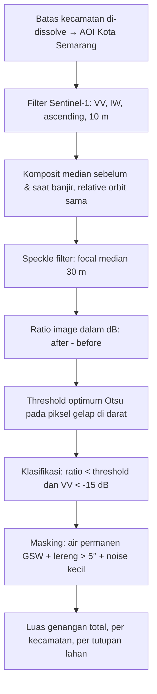

# Deteksi Genangan Banjir Kota Semarang dengan Sentinel-1 (Oktober–November 2025)

> **Status: eksperimental.** Hasil belum divalidasi dengan data lapangan independen. Baca bagian [Validasi](#validasi) dan [Keterbatasan](#keterbatasan) sebelum memakai angka luas genangan.

Analisis ini mendeteksi genangan akibat hujan intensitas tinggi yang melanda Kota Semarang pada 21 Oktober 2025 (genangan mulai surut sekitar 3 November 2025). Metodenya memakai citra Sentinel-1 GRD di Google Earth Engine (GEE): change detection berbasis *ratio image*, threshold optimum dengan algoritma Otsu, serta masking air permanen (JRC Global Surface Water) dan lereng curam.

Metode mengacu pada: *Identification of Flood Inundation in DKI Jakarta Area Using Sentinel-1 Satellite Imagery* ([ResearchGate](https://www.researchgate.net/publication/375584670_Identification_of_Flood_Inundation_in_DKI_Jakarta_Area_Using_Sentinel-1_Satellite_Imagery)).

## Latar belakang kejadian

- **21 Oktober 2025:** hujan intensitas tinggi menyebabkan genangan dan banjir di beberapa titik di Kota Semarang.
- **Sekitar 3 November 2025:** genangan mulai surut.
- Sumber informasi kejadian: _TODO: cantumkan sumber berita/BPBD beserta tanggalnya._

## Data

| Data | Sumber | Kegunaan |
|---|---|---|
| Sentinel-1 GRD (`COPERNICUS/S1_GRD`) | ESA/Copernicus via GEE | Citra radar sebelum dan saat banjir |
| Global Surface Water (`JRC/GSW1_4/GlobalSurfaceWater`) | JRC via GEE | Mask air permanen |
| DEMNAS | Badan Informasi Geospasial (BIG) | Mask lereng dan statistik elevasi genangan |
| SRTM (`USGS/SRTMGL1_003`) | USGS via GEE | Pengisi celah DEMNAS |
| ESA WorldCover v200 (2021) | ESA via GEE | Diagnostik tutupan lahan genangan (perkiraan kasar untuk 2025) |
| Batas kecamatan Kota Semarang | _TODO: isi sumber_ | Daerah kajian dan luas per kecamatan |

Data DEMNAS dan batas kecamatan **tidak disertakan** di repo ini. Lihat [`data/README.md`](data/README.md) untuk cara menyiapkannya.

## Metode

Catatan tahap pre-processing: koleksi `COPERNICUS/S1_GRD` di GEE sudah melalui apply orbit file, GRD border noise removal, thermal noise removal, kalibrasi radiometrik, terrain correction, dan konversi hamburan balik ke dB. Tahap-tahap itu tidak diulang di script. Terrain correction memakai DEM bawaan GEE, bukan DEMNAS.

## Parameter

| Parameter | Nilai | Keterangan |
|---|---|---|
| Polarisasi / mode / orbit | VV / IW / ascending | Resolusi 10 m |
| Periode sebelum banjir | 2025-10-08 s.d. 2025-10-20 | Akhir eksklusif di script (`2025-10-21`) |
| Periode banjir | 2025-10-21 s.d. 2025-10-27 | |
| Periode surut | 2025-11-02 s.d. 2025-11-08 | |
| Relative orbit | _TODO: isi setelah cek histogram orbit_ | Harus sama antara citra sebelum dan saat kejadian |
| Speckle filter | focal median, radius 30 m | |
| `absThr` | -15 dB | Syarat piksel gelap seperti air |
| Threshold Otsu | dibatasi -6 s.d. -3 dB | Pagar heuristik agar tidak melenceng |
| `maxSlope` | 5° | Mask lereng curam |
| `gswThr` | 90 % | Occurrence GSW yang dianggap air permanen |
| `minPatch` | 10 piksel | Buang noise kecil |

## Cara menjalankan

1. Buat akun GEE dan buka [Code Editor](https://code.earthengine.google.com/).
2. Unggah batas kecamatan dan DEMNAS ke Assets (lihat [`data/README.md`](data/README.md)), lalu sesuaikan path asset di bagian awal script.
3. Salin isi [`gee/deteksi_genangan_semarang.js`](gee/deteksi_genangan_semarang.js) ke Code Editor, lalu jalankan.
4. Baca di Console: `Daftar akuisisi S1` dan `Orbit periode ...`. Isi `rel` di `events` dengan relative orbit yang muncul pada periode sebelum **dan** periode kejadian, lalu jalankan ulang.
5. Jalankan tugas ekspor di tab **Tasks** untuk menyimpan raster genangan dan tabel luas ke Google Drive.

Terakhir dijalankan pada: _TODO: isi tanggal_ (koleksi GEE dapat diperbarui sehingga hasil bisa bergeser sedikit).

## Hasil

_TODO: isi setelah relative orbit dan validasi final._

| Kejadian | Tanggal akuisisi aktual | Threshold (dB) | Luas sebelum mask (ha) | Luas final (ha) |
|---|---|---|---|---|
| Banjir | _TODO_ | _TODO_ | _TODO_ | _TODO_ |
| Surut | _TODO_ | _TODO_ | _TODO_ | _TODO_ |

Tabel luas per kecamatan dan per tutupan lahan: [`hasil/tabel/`](hasil/tabel/). Peta: [`hasil/gambar/`](hasil/gambar/).

## Validasi

_TODO._ Rencana: membandingkan hasil dengan titik banjir independen (laporan BPBD/BNPB, berita bertanggal, atau citra optik yang cerah), lalu menghitung confusion matrix, overall accuracy, dan kappa. Titik validasi tidak boleh sama dengan data yang dipakai menentukan threshold.

## Keterbatasan

- Revisit Sentinel-1 tidak harian, sehingga puncak banjir bisa terlewat. Satu jendela waktu bisa hanya berisi satu citra, dan tanggal aktual akuisisi perlu dilaporkan.
- Genangan perkotaan sering surut dalam hitungan jam sampai hari.
- Sawah dan tambak yang terisi air dapat terbaca sebagai genangan atau justru terlewat jika sudah basah pada citra pembanding.
- Polarisasi VV tunggal kurang sensitif untuk banjir di area terbangun (efek *double bounce*) dan di bawah vegetasi.
- Threshold Otsu bergantung pada distribusi nilai ratio; pagar -6 s.d. -3 dB adalah heuristik, bukan hasil kalibrasi lapangan.
- ESA WorldCover berasal dari 2021, sehingga hanya perkiraan kasar untuk 2025.
- Resolusi 10 m dan speckle filter dapat menghilangkan genangan sangat kecil atau sempit.

## Referensi

- Paper acuan: *Identification of Flood Inundation in DKI Jakarta Area Using Sentinel-1 Satellite Imagery* (tautan di atas).
- Pekel, J.-F. et al. (2016). High-resolution mapping of global surface water and its long-term changes. *Nature* 540, 418–422.
- Zanaga, D. et al. (2022). *ESA WorldCover 10 m 2021 v200*.
- Data Sentinel-1 © Copernicus / ESA.
- Gorelick, N. et al. (2017). Google Earth Engine: Planetary-scale geospatial analysis for everyone. *Remote Sensing of Environment*.

## Lisensi

_TODO: pilih lisensi untuk kode (misalnya MIT atau Apache-2.0) dan untuk data hasil (misalnya CC BY 4.0), lalu tambahkan berkas `LICENSE`._

